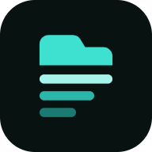
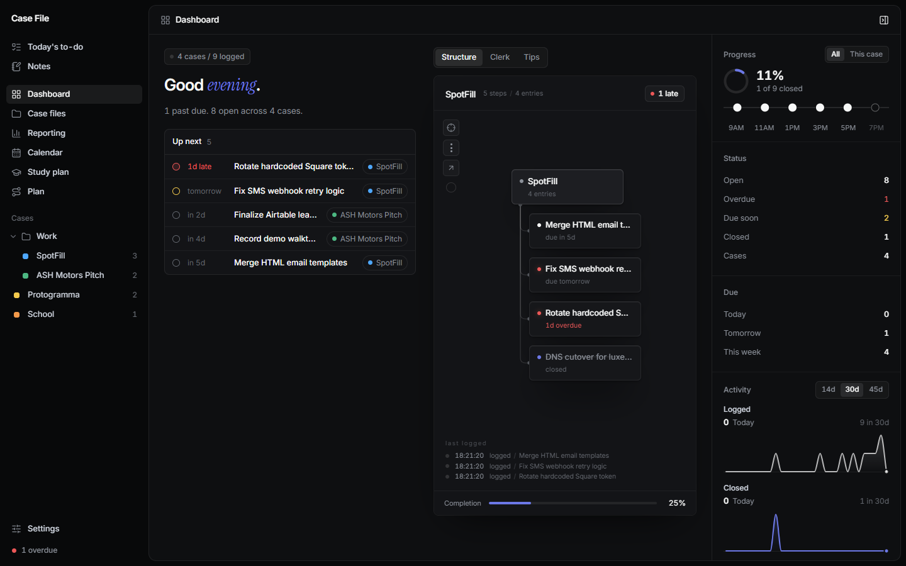
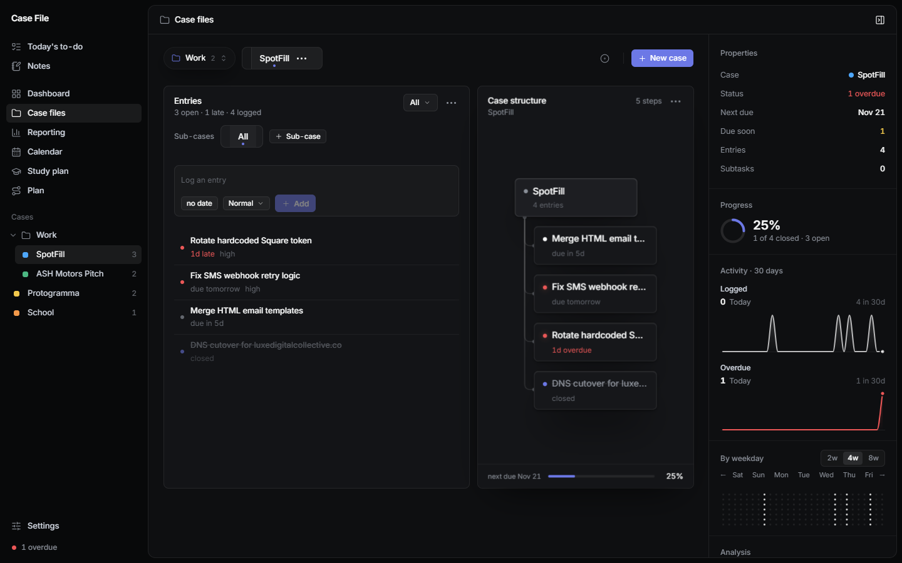
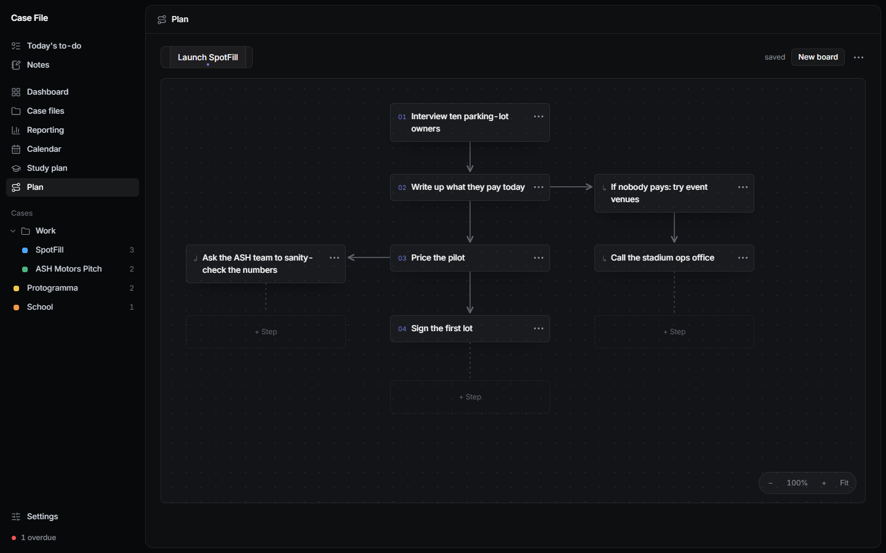
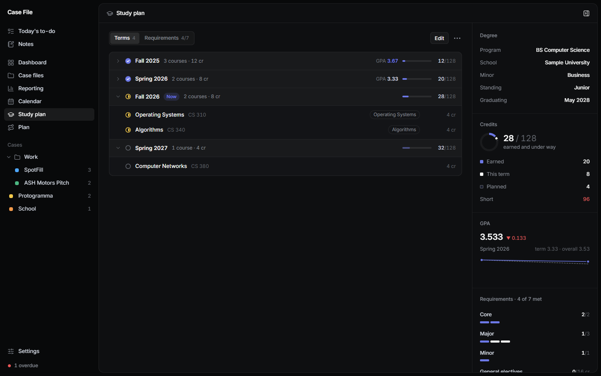
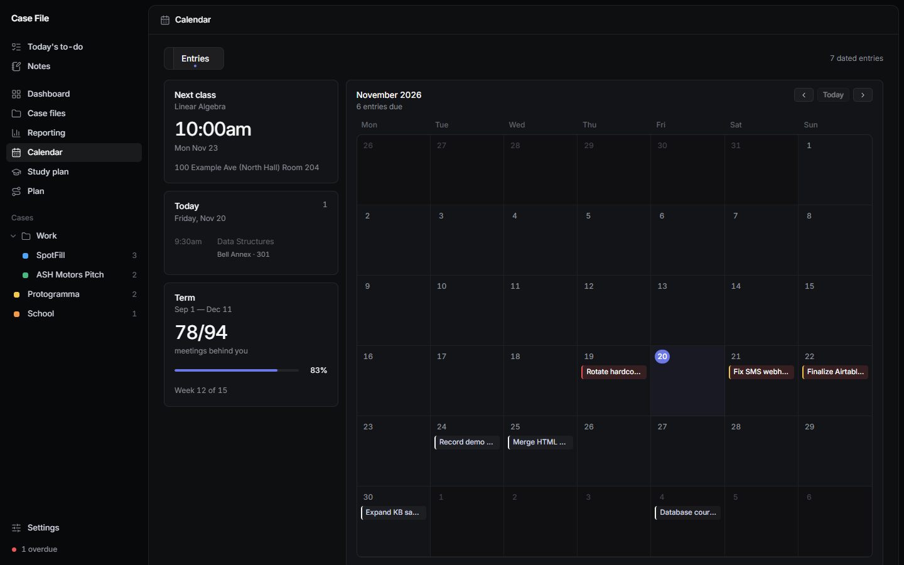
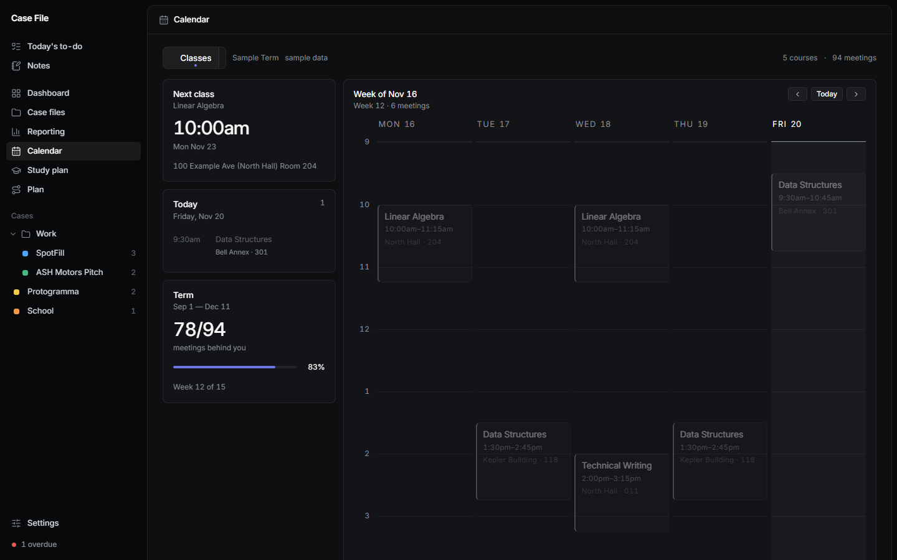
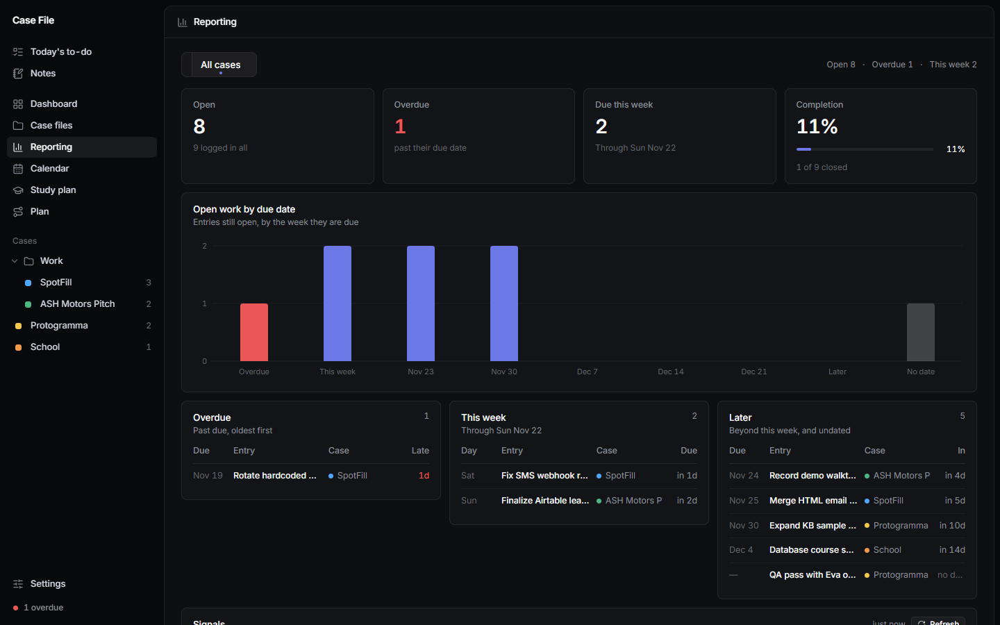
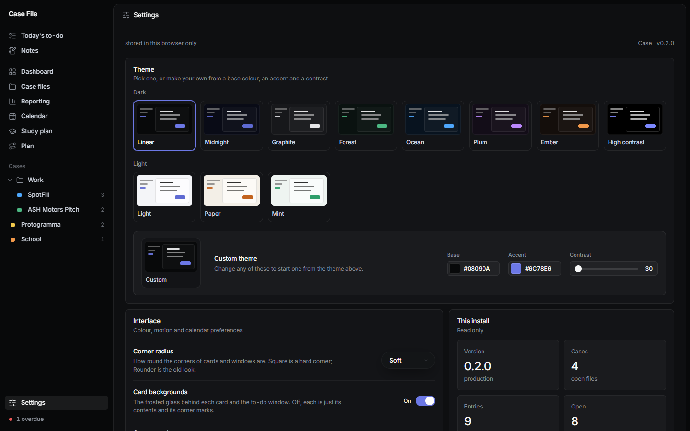
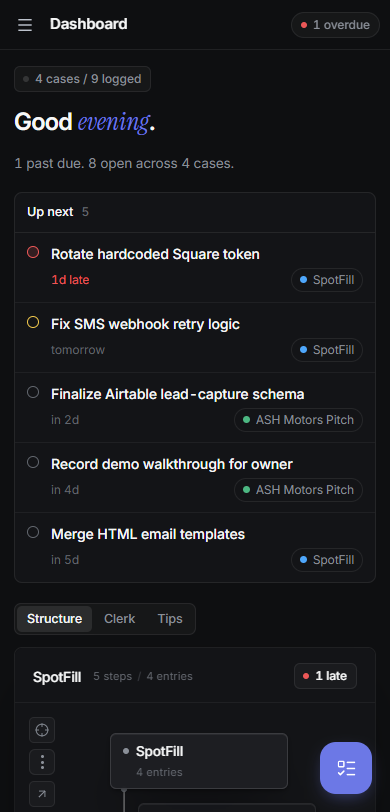

# Case

A case tracker for one person. Work is grouped into **cases**, each holding **entries**
with due dates, priorities and nested subtasks. The app reads that back to you rather than
just listing it: what is overdue, what is stalled, how much is closed, and where it all sits
against your class timetable.

It runs on your own machine against a local SQLite file, with no login. It can also be
hosted (Vercel plus a Turso database) behind one password, so the same archive is on your
phone. See [Hosting it](#hosting-it).

One part is opt-in and sends data off the machine: **the clerk**, an agent that files your
notes into the archive, writes the day's brief, answers questions about what you have logged
and makes the changes you ask it for, each one waiting for your click before it is written.
It does nothing until you put an API key in `.env` yourself. See [The clerk](#the-clerk).



*Every screenshot here is of the sample archive a fresh install seeds, not anyone's real
cases.*

---

## Screens

| | |
|---|---|
| **Dashboard** | A greeting, the clerk's read of your day and what is up next. Beside them is a deck with tabs: **Structure** (the case drawn as a flow), **Clerk** (the chat) and **Tips** (recommendations). The rail on the right holds progress, status, what is due and activity over 14, 30 or 45 days. |
| **Case files** | The working screen. Create, rename, file and delete cases; add sub-cases; log entries with dates and priorities; nest subtasks. The entries take the left, the case structure the middle, and the rail holds the case's properties, progress and activity. |
| **Reporting** | Totals across the archive, open work by due week, and every open entry sorted into Overdue, This week and Later. Underneath are **Signals**, headlines from public RSS feeds. |
| **Calendar** | **Entries** is a month grid of every dated entry, coloured by how its deadline stands. **Classes** is the week's timetable from a registrar `.ics`, with the next class, today's classes and how far through the term you are. |
| **Study plan** | Your degree, term by term, typed in through in-app forms. Credits, GPA and which requirements are met are worked out from the courses as you type. |
| **Plan** | Boards of steps on a canvas, running top to bottom, where a step can branch off to the left or right. |
| **Settings** | Theme, background, interface preferences, the class timetable, what this install holds, a live memory reading and what the clerk sends where. |

### Getting around

The **sidebar** on the left holds everything: Today's to-do (**Shift+T**) and Notes
(**Shift+N**), the screens, then your **cases**, each with its count of open entries. Cases
sit in their **case folders**. Click a folder to open or close it, and it remembers which you
left closed. Cases in no folder follow below the folders. Settings and a one-line standing
("1 overdue") sit at the bottom.

The **details rail** runs down the right of the Dashboard, Case files and Study plan. It is
everything measured about the page in one quiet column: properties, progress rings and
smooth line charts of activity. The button at the right end of the page header hides it.
On a narrower screen it drops under the page.

**Today's to-do** is a window in the middle of the screen. Every entry and subtask in a case
has a **Today** button that puts it on the list, and you can type tasks of the day's own
into the field at the top. Drag rows (or Alt+Up/Down) into the order you want and tick them
off. Ticking an entry closes it in its case too. Each day starts empty, and the first time
it opens after a day with unfinished items, it offers to bring them over.

**Notes** is a scratchpad that slides in over any screen. It saves as you type and follows
you between screens. With a key configured, it is also where filing happens: **File it**
hands the pad to the clerk.

Leave the app alone for a minute and it falls into **standby**: the page goes soft and a
clock takes the middle of the screen. Any click or key brings it back exactly as it was.

### Case files



The folder you are in and the open case sit along the top. The folder opens into the other
folders and the folder actions (new, rename, delete), and the case opens into every case in
that folder. A new case lands in the folder you are looking at.

**Dragging one entry onto another files it as a subtask**, and dragging it onto an entry in
a different case moves it there. Subtasks stay one level deep, so an entry that already
holds subtasks cannot itself become one.

**The case structure** draws a case as a flow. The case is the first step, its entries come
off it, and a subtask comes off its entry. It is laid out rather than simulated, so the same
case comes out the same shape every time and the lines never cross. Colour means state and
nothing else: **white** open, **amber** due soon, **red** overdue, **violet** closed.
Hovering a step brings its own wires forward and steps the rest back, so one branch can be
followed through a busy case.

On the dashboard you flip through it: **click** the drawing for the next case and
**right-click** for the one before. On Case files a click opens the case full window instead,
so a busy case that had to shrink to fit can be read whole. Esc closes it.

### Plan



A board is a line of steps, top to bottom. Any step can **branch** to its left or right,
from the **+** on each edge of a card or from its menu, and the branch runs down from there.
Cards snap into place, so there is nothing to drag or line up, and the arrows are drawn from
where the cards land. Each card is one text box that grows as you type.

The canvas pans (drag the background, or scroll) and zooms (pinch, Ctrl+scroll or the
buttons). Where you left each board is remembered. A pan or zoom never re-renders the board:
the view is written straight onto the canvas's transform each frame, which is what keeps it
smooth on a phone. Boards save a moment after the last change.

### Study plan



The degree, typed in rather than imported. **Edit** turns the terms into forms, and each
change saves a moment after the last keystroke. Nothing is a typed total: credits earned,
this term's and planned credits, the GPA (per term and overall) and which requirements are
met are all worked out from the courses. The tabs switch between **Terms**,
**Requirements**, and, when there is anything in them, **Next term** and **To confirm**.
The rail measures the degree: its details, credits against what is required, the GPA's
trend and each requirement group.

### Calendar





The same days two ways. Clicking an entry on the month opens its case. The class week comes
from the timetable, described in
[Swapping in your own class schedule](#swapping-in-your-own-class-schedule).

### Reporting



Open, overdue, due this week and the completion rate across the archive, a chart of open
work by the week it is due, and the three tables. The Signals feed is an outside dependency
that is often down. When it is, the feed says so in its own card and keeps the last good copy
on screen. It is polled no more than every five minutes, and the brief's one line of news is
picked from the same feed.

### Settings



**Theme.** Eleven presets: Linear (the default), Midnight, Graphite, Forest, Ocean, Plum,
Ember and High contrast, then Light, Paper and Mint. Or make your own from three inputs: a
base colour, an accent and a contrast. Every colour the app uses is generated from those
three in OKLCH (`src/lib/theme.js`), so a custom theme is as complete as a preset.

**Background.** **None** (the default, flat panels), **Undertow** (a dark sea of tiny slats
rolling toward you, on WebGL2) or **Glass Current** (ribbons of glass shards, ray-traced on
WebGPU). With a background on, the panels become frosted glass over it, and **Diffusion**
blurs the background alone, from Crisp to Smoke. Each background loads only when picked and
falls back to None if it cannot start.

**Interface.** Corner radius, card glass, reduce motion, pointer parallax and the first day
of the week.

**Timetable.** Upload your registrar's `.ics` here and it is stored with the archive, so the
hosted app has it too.

**Memory** refreshes every five seconds while it is open:

- **Server** is the Node process's whole resident set, the same number Task Manager shows.
- **This tab** is the page's JavaScript heap. It is Chromium-only, so other browsers show a
  dash rather than a guess.
- **Together** is the two added up, also shown as a share of the machine's RAM.
- **Database** is the SQLite file plus its write-ahead log, on disk rather than in memory.

### On a phone



The same app with a phone layer (`src/mobile.css`). The sidebar becomes a drawer behind the
menu button in the header. There is no tab bar: the **to-do button** floats in the corner.
Tap it for today's list, or **hold it** and the screens fan out around it in a quarter
wheel; slide to one and let go. In Today's to-do, hold a row to lift and drag it, and swipe
it left to delete. Text fields are 16px so Safari never zooms in on a tap, everything that
only appeared on hover is simply there, and the sheets clear the notch and the home bar.

---

## The clerk

An agent over the archive, in four places. It is off unless an API key is present, and with
no key none of it appears anywhere in the app.

**Filing (Notes).** Paste a syllabus week, an email, a list of deadlines, a brain dump.
**File it** hands the pad to the clerk, which reads your existing cases so it does not
duplicate them, and your timetable so it can resolve *week 9* and *before the midterm*. It
comes back with proposed rows: `Assignment 3 · CS 341 · due Fri 17 Oct · high`. Each one
carries the few words from your own text that produced it. Edit a date, drop two, accept the
rest. The pad is never cleared, because the same notes are often filed twice as a week goes
on.

**The brief (the dashboard).** Two short paragraphs under the greeting, written the way a
friend would say it rather than a report. The first is about your work: which thing to do
first, and whether there is room for it between today's classes. The second, marked *on the
wire*, is one headline from the news feed, and it is left out entirely when the feed is down.
The model returns the two as separate fields, so the news can never get mixed into the
advice. The brief is cached against the facts that produced it: opening the dashboard four
times before lunch costs one call, and ticking off something overdue is what makes it
rewrite. It types itself out each time the dashboard opens, laid out at its final height
from the first frame so no word jumps a line. Under reduced motion it simply appears.

**The chat (the dashboard's Clerk tab).** Questions about the archive, answered out of it.
It can open a case, search the entries and read the timetable before answering, and it says
underneath what it looked at.

Ask it to change something (*close the four homeworks*, *push the midterm to the 22nd*, *add
"read chapter 5" to Operating Systems*, *delete Lab 3*) and it stages the changes instead of
making them. They sit under its reply with a tick per row: untick what you do not want, then
**apply** or **dismiss**. Entries and subtasks can be added, edited (title, due date,
priority), closed, reopened and deleted. Cases themselves are left to the Case files screen.
It is told to close finished work rather than delete it, and to ask rather than guess when it
is not clear which entry you mean.

### Reads loop, writes are proposals

The clerk has four tools that read: `case_detail`, `search_entries`, `timetable`,
`standing`. It calls them in a loop, because deciding whether a case for a course already
exists genuinely requires looking.

Nothing it calls writes. The chat has four more tools (`create_entry`, `update_entry`,
`close_entries`, `delete_entries`), and each one checks the archive and **stages** a change
rather than making it. Applying is a separate request (`/api/clerk/apply` for a filing,
`/api/clerk/changes` for the chat) that validates every row again. By then the rows have
been through a browser and been edited, so they are untrusted input whatever the model
originally said. A change whose entry has gone since it was staged is skipped and reported,
and a batch applies in one transaction or not at all.

This is not timidity about the model. A filing assistant you have to audit afterwards is
slower than filing it yourself: reviewing nine proposed rows takes ten seconds, and finding
the three an unattended agent got wrong takes longer than typing all nine.

The brief never counts anything. It is handed the numbers, computed by `src/lib/metrics.js`,
the same module the screens render from, and asked to interpret them. One visibly wrong
number costs more trust than the whole feature earns.

### Setting it up

Both main providers have a free tier, and one key is a complete installation.

| | where | what it is used for |
|---|---|---|
| `GEMINI_API_KEY` | [aistudio.google.com](https://aistudio.google.com/apikey) | Filing. A huge context window, so a syllabus plus your whole archive fits in one call. |
| `GROQ_API_KEY` | [console.groq.com](https://console.groq.com/keys) | The brief and the chat. It answered in under 100ms in testing, which is most of what makes those two feel good. |
| `OPENROUTER_API_KEY` | [openrouter.ai](https://openrouter.ai/keys) | Fallback, used only if neither of the above is set. |

Put one or both in `.env` and restart. **With both, each job also falls over to the other
when it hits a limit or refuses its key.** The two free tiers are capped along different
axes (Gemini by requests per minute, Groq by 8000 tokens per minute and 1000 requests a day),
so the wall one hits is usually one the other would not have noticed. `CLERK_PROVIDER=groq`
pins every job to one provider and turns the fall-over off, which is what makes "is it the
model or is it me" answerable without editing code.

Everything speaks one wire format, OpenAI's chat-completions shape, which Groq serves
natively and Google publishes a compatible endpoint for. That is why there is one code path
rather than two SDKs and a translation layer between them.

### When a model name stops working

They rot, and without warning. Groq retired `llama-3.3-70b-versatile` during this build, and
Google's model list still advertises `gemini-2.5-flash` while the OpenAI-compatible endpoint
returns 404 for it. So the defaults can be overridden without touching code
(`CLERK_GEMINI_MODEL`, `CLERK_GROQ_MODEL`, `CLERK_OPENROUTER_MODEL`), and the error the app
shows says so by name. To see what a key can actually call:

```bash
curl -H "Authorization: Bearer $GROQ_API_KEY" https://api.groq.com/openai/v1/models
```

Being in the list is not enough, though: a model also has to call a tool when given one and
honour a JSON schema when asked, and they fail those independently. The defaults were each
picked by calling them and checking all three.

### What leaves the machine

When you file the pad, ask the chat a question or the brief regenerates, the text involved,
your case names, the entries in them and the courses on your timetable are sent to whichever
provider is configured. **Nothing is sent to a model at any other time.** There is no
background call, no analytics and no tracking. Settings has a panel saying this on screen,
with which provider is answering which job.

Remove the key and restart to turn it off. With no key the app makes no request to any model
provider, and the typefaces are bundled with the app rather than fetched from Google. The
other outside requests are the server fetching the public RSS feeds for Reporting and the
brief and, if you host it, the archive living in your Turso database.

---

## Running it

Requires **Node 22 or newer** (the npm scripts use `--env-file`).

```bash
npm install
cp .env.example .env      # required: node --env-file fails if the file is absent
npm run app               # build the frontend, then serve everything on :4001
```

Then open <http://localhost:4001>. Locally there is no login.

The database is created at `server/case-file.sqlite` on first run and seeded with sample
cases. That file is deliberately **not** tracked by git, because it holds real content, not
fixtures. `CASE_FILE_DB` points the server at a different file, and a fresh path is seeded
the same way, which is how to try something without going near the real archive.

`.env.example` explains every setting. None is needed to run the app; an API key is what
turns [the clerk](#the-clerk) on.

### Scripts

| command | what it does |
|---|---|
| `npm run app` | Build the frontend, then serve it and the API on `:4001` |
| `npm run dev` | Vite dev server with hot reload, plus the API on `:4001` |
| `npm run server` | API only, restarting on change |
| `npm run build` | Production build into `dist/` |
| `npm start` | Serve an existing build |
| `npm run db:backup` | Copy the hosted (Turso) archive down to a dated file in `server/backups/` |
| `npm run db:pull` | The same, and make it the local archive too (the local one is backed up first) |
| `npm run db:import` | Copy the local archive up to Turso, once. `-- --dry-run` writes nothing; `-- --force` copies even if Turso already has cases |

The `db:` scripts read `TURSO_DATABASE_URL` and `TURSO_AUTH_TOKEN`. Those are deliberately
not the names the app reads, so putting them in `.env` never quietly points your local app at
the live data. There is no script that writes to the live archive except the one-off import.

---

## Hosting it

The same code runs on Vercel. `api/index.js` hands every `/api/*` request to the routes in
`server/app.js`, the same ones the local server uses, and Vercel serves `dist/` from its CDN.
Set these in the Vercel project:

| | |
|---|---|
| `DATABASE_URL`, `DATABASE_AUTH_TOKEN` | The Turso database (`libsql://…`). Unset, the archive is the local file. |
| `APP_TIMEZONE` | The zone due dates, "today" and class times are read in, e.g. `America/New_York`. Vercel runs in UTC. |
| `APP_PASSWORD` | The password you sign in with. |
| `SESSION_SECRET` | A long random string that signs the session cookie. Changing it signs every device out. |

Hosted, every API route needs a session (`server/auth.js`). The session is a signed cookie
with its own expiry, so it works on whichever server instance answers. It fails closed:
with the password or the secret missing, every route answers 503 rather than serving an open
archive. Wrong passwords from one address are rate-limited.

Open on a phone and a desktop at once, the copies stay in step without a refresh
(`src/lib/live.js`). The server moves one number on every write. Each visible copy checks
that number every few seconds, and at once when it comes back into view, and reloads what
changed elsewhere. A device's own changes carry the new number back in their response, so
they never make it reload.

To move an existing local archive up, run `npm run db:import` once. After that, the live
archive is only written by the app, and `db:backup` brings a copy down whenever you want one.

In production a service worker caches the app's shell, so it opens like an installed app
and can be added to a phone's home screen.

---

## Swapping in your own class schedule

The **Classes** view has nothing hard-coded. It parses a registrar `.ics` export, so a new
term is a file swap. There are two ways to give it yours:

- **Upload it in Settings → Timetable.** It is stored in the database, so the hosted app has
  it too, and it wins over any file.
- **Or save it as `src/data/class-calendar.local.ics`** and rebuild.

Courses, rooms, meeting times, holidays and the term's length all follow from the file.

The repo ships a fictional `src/data/class-calendar.ics` so a fresh clone builds and the
screen has something to draw; it is labelled *sample data* on screen. The `.local.ics` name is
gitignored. A real timetable is personal (course names, buildings, room numbers), and it
should not end up in anyone's git history, including yours.

Two things worth knowing about the parser (`src/lib/ics.js`):

- **Times are read as wall-clock, not converted.** A 09:30 class reads 09:30 wherever you
  open the app. That is the right answer for the person walking to it, and the only honest
  option without shipping a timezone database.
- It handles weekly `RRULE`s with `BYDAY`/`UNTIL` and subtracts `EXDATE` holidays, which is
  the whole of what a class schedule uses. Anything it does not understand is skipped rather
  than guessed at, so an unfamiliar export loses events instead of inventing them.

---

## Layout

```
api/
  index.js      the app on Vercel: the shared Express routes as one function
server/
  index.js      local server: the routes plus static hosting for dist/
  app.js        every /api route, shared by both
  auth.js       the one-password login (hosted only)
  db.js         SQLite or Turso through libsql: schema, migrations, first-run seed
  tz.js         the server's clock in APP_TIMEZONE
  news.js       RSS fetch for Reporting and the brief
  ai.js         the only file that talks to a model, and the only one that sees a key
  archive.js    the archive as JSON, plus the facts the clerk is handed
  clerk.js      the agent: read tools, staged write tools, the loop, filing / brief /
                chat, and applying what you approve
scripts/        db-backup.mjs and db-import.mjs
src/
  views/        one file per screen, plus ThemeEditor.jsx
  ui/           the shell (Sidebar, Rail, TodayWindow, NotesDrawer, CornerWheel,
                Standby), primitives and charts, the case flow, the menus, and the
                backgrounds (backdrops.js, MicroSlats.jsx, AeroShards.jsx)
  lib/          API client, settings, themes, metrics, today's list, the graph
                builder, .ics parsing, reordering
  data/         the sample class-calendar .ics
  styles.css    the original design system
  motion.css    transitions
  mobile.css    the phone layer
  linear.css    the current design, imported last so it wins
```

### Stack

React 19 and Vite on the front, Express on the back, and SQLite through `@libsql/client`,
which also talks to Turso when hosted. No ORM, no state library, no CSS framework. Icons are
`lucide-react`, Notes is CodeMirror, and `compromise` and `fast-xml-parser` serve the news
feed. The two backgrounds bring their own renderer and load only when picked: `ogl` for
Undertow and `vgpu` (pinned at exactly 0.5.0, because 0.6 rejects the raw WGSL the component
passes) for Glass Current. The typefaces are Fontsource packages, bundled. The dashboard is in
the first bundle and every other screen is its own chunk.

---

## Notes on the design

The look follows Linear: a calm dark ground, hairline borders, one accent, a sidebar on the
left and the details rail on the right. Inter for everything, with its tabular figures for
anything that is a measurement, and one word per heading in Instrument Serif italic, in the
accent colour ("Good *evening*").

It was a staged overhaul, built as one stylesheet, `src/linear.css`, imported after the
others and overriding them. The git tag `pre-linear-redesign` holds the whole earlier design
(the glass island navigation, the light-strand backgrounds, the tilting case panel).

A few conventions are load-bearing:

- **Components never contain a colour.** Every colour is a token. The theme generator stamps
  a handful of source values on `<html>` (`--page-rgb`, `--card-rgb`, `--ink-rgb`…) and the
  stylesheets derive the rest from them, so a light theme needs no special cases. Overlays use
  `--ink-rgb`, never a hard-coded white.
- **Amber and red are not decoration.** They mean due soon and overdue, and nothing else in
  the app may borrow them.
- **Animations fail safe.** Every hidden-start animation is gated behind a class that is
  removed once it has run, so an animation that cannot run leaves content visible rather than
  stranded at `opacity: 0`.
- **Per-frame values never go on the root.** A custom property changed on `<html>` restyles
  the whole document, so anything that changes every frame is written on the element that
  reads it.

`prefers-reduced-motion` is honoured throughout, and can be forced on from Settings.
